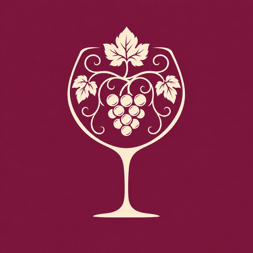

# Decant — Design System

Version 1 · November 2026 · Palette: Bordeaux · Type: Fraunces + Crimson Text



## Contents

1. Overview
2. Principles and guidelines
3. Colour tokens
4. Typography
5. Spacing
6. Radius
7. Elevation
8. Components
9. Implementation

## 1. Overview

Decant is a wine rating app: find a bottle, rate it, keep a cellar of what you loved. The interface is warm, generous and photography-led — a clean canvas, one voltage of brand colour, soft rounded shapes and modest type that lets bottle shots and the community's scores carry the page.

## 2. Principles and guidelines

### Palette

One palette: **Bordeaux** — deep claret `primary` (`#8b1d3b`) on a white `canvas`, with warm-grey `ink` (`#231a1c`) and a dark-gold `accent` (`#8a5f1c`) kept for the Reserve tier. Every text pair named in a token's note holds at least 4.5:1; `border-strong` and `focus-ring` hold 3:1.

### Content fundamentals

- Speak like a friendly sommelier, not a critic: plain words, short sentences, "you" for the reader, "we" sparingly for Decant.
- Sentence case everywhere — buttons, headings, tabs. "Rate this wine", not "Rate This Wine".
- Lead with the wine, then the people: "Barolo Cannubi 2018 · Brezza", "812 ratings".
- No exclamation marks, no urgency ("Only 2 left!"), no emoji in product UI.
- Scores are numbers with one decimal ("4.6"), never percentages or words alone.
- Quote reviewers exactly; never correct or trim their tasting notes beyond the three-line clamp.
- Always include a responsible-drinking line in the legal band.

### Visual foundations

#### Colour

- Build every screen on `canvas` with `ink` text. Roughly 90% of any screen is canvas, ink and photography.
- `primary` is the single brand voltage: the primary CTA, the search orb, the saved heart, the active rating. One or two `primary` moments per screen — never decorative fills or large backgrounds.
- Text on a `primary` fill is `on-primary`, never a literal white.
- Pressed primary is `primary-active`; disabled primary is `primary-disabled` (exempt from contrast, never for readable text).
- `primary-soft` is the only tint ground; `primary` and `ink` both read on it.
- Secondary meta is `muted`; long reading text is `body`. `muted-soft` is for disabled text only.
- Stars and scores are `star-rating` (an alias of `ink`). Never gold or yellow — it reads cheap.
- `accent` belongs to the Reserve tier only (collector picks, cellar-worthy). Keep it out of mainline UI.
- `error` is for validation, always with a message and icon. It is distinct from `primary` — never use the brand colour to signal an error.
- `wine-red`, `wine-white`, `wine-rose`, `wine-orange`, `wine-sparkling` and `wine-dessert` mark wine type as small dots or bottle silhouettes, always beside a text label.
- Dividers are `hairline` (default) or `hairline-soft` (long scrolls); control outlines are `border-strong`.

#### Type

- Two families: **Fraunces** (`display`, a warm variable serif with optical sizes) for display styles and the rating number; **Crimson Text** (`text`), a classic book serif, for everything else — body, labels, buttons, navigation. Crimson Text comes in 400, 600 and 700 only: use 400 for reading text and 600 for labels, buttons and titles; never ask for 500. Both load from Google Fonts — `components/bundle.css` imports them.
- Display stays modest: `display-xl` 28px/600 for page h1, `display-lg` 22px/500 for a wine's name. Photography provides visual weight, not type.
- The one loud moment is `rating-display` (64px/600) — the community score on a wine's detail page. Use it once per page.
- Body copy is `body-md` (16/1.5); card meta, prices and dates are `body-sm` (14/1.43); labels are `caption`.
- `uppercase-tag` (10px, uppercase, 0.4px tracking) is only for the NEW tag.

#### Spacing and layout

- 4px base with a 2px micro-step: `space-xxs` … `space-section`.
- Major page bands get `space-section` (64px) vertical padding; card grids stay dense at `space-base` (16px) gaps — "open hero, dense marketplace below".
- Card padding is `space-lg`; floating controls inside photos sit `space-md` from the edge.
- Content caps around 1280px; a wine detail page around 1080px, two columns (about 64% / 32%) with the buy card sticky on the right.
- Breakpoints: mobile < 744px (1-up cards, search collapses to one pill, the five product tabs move into a sheet), tablet 744–1128px (2-up), desktop 1128–1440px (4-up). Drop columns; never reflow rows.

#### Shape

- Everything interactive is rounded. Buttons and inputs `radius-sm` (8px); cards and photo plates `radius-md` (14px); sheets `radius-lg`; category containers `radius-xl`; the search bar, orb, icon buttons, badges and chips `radius-full`.
- The only hard edge is the 2px active-tab underline (`radius-none`).

#### Elevation

- One shadow only: `shadow-float`. It goes on the search bar at rest, floating badges over photos, dropdowns and menus, and cards on hover. Everything else is flat.
- Modals sit on `scrim`.

#### States

- Hover: chips and search segments gain `surface-soft`; cards may lift to `shadow-float`. No colour shifts on hover.
- Press: primary fills switch to `primary-active`. No scale or transform.
- Focus: a solid 2px `focus-ring` outline with 2px offset on every control; inputs instead thicken their border to 2px `ink`.
- Motion: short (150–200ms) opacity and shadow transitions only.

#### Imagery

- Bottle shots on plain light grounds, cropped 4:5, upright, no props competing with the label. Vineyard and table photography for editorial bands.
- When there is no photo, show the bottle silhouette in the wine-type colour on `surface-strong` — never a grey box.

### Iconography

- Simple line glyphs at a 2px stroke on a 32px grid, drawn in `currentColor` (heart, search, back, close, share, star, alert — exposed as `Decant.Icon`). The filled heart and filled star are the only solid glyphs.
- No emoji. Product tabs accept 32px illustrations in their `icon` slot, but none are part of the system yet.

### Logo

- The logo is `assets/Logos/decant-logo.png`: a cream wine glass holding a vine, leaves and a grape cluster on a square claret ground (`logo-claret`, lines `logo-cream`).
- Use it as a whole square tile (corners `radius-md` or `radius-lg`, or a circle for avatars) on the app icon, splash, sign-in and about screens. Never recolour, crop into the glass, outline, shadow or place it over photography.
- Minimum 48px. In the top bar pair a 40px tile with the name "Decant" in `display` at weight 600; where space is tighter, set the name alone.
- Full-bleed brand panels behind the logo use `logo-claret` with `logo-cream` text — not `primary`, which is for actions.

### Component library

`components/bundle.js` defines `window.Decant` (React 18): `Button`, `IconButton`, `SearchBar`, `ProductTabs`, `CategoryStrip`, `Badge`, `WineCard`, `Rating`, `RatingDisplay`, `ReviewCard`, `TextInput`. Each has its own guidelines beside its preview. Load `tokens.css`, then `components/bundle.css` (which also imports the fonts), then React, then the bundle.

## 3. Colour tokens

| Token | Value | Usage |
|---|---|---|
| `primary` | `#8b1d3b` | The single brand voltage: primary CTA fill, search orb, saved heart, active rating input, inline brand links. As text it reads on canvas, surface-soft and surface-strong. Use sparingly — one or two moments per screen. |
| `primary-active` | `#6e132c` | Pressed / pointer-down state of a primary fill. No transform, no shadow change. |
| `primary-disabled` | `#e8cdd4` | Disabled primary fill, with on-primary text. Disabled controls are exempt from contrast minimums; never use this tint for anything that must be read. |
| `primary-soft` | `#f6e7eb` | Tinted ground behind primary text: selected chips, the 'Top rated' badge on a light card, tasting-note highlights. primary and ink both read on it. |
| `on-primary` | `#ffffff` | Text and icons on a primary or primary-active fill. |
| `accent` | `#8a5f1c` | Secondary hue for the Reserve tier only (cellar-worthy, collector picks) — like a sub-brand accent, never in mainline UI. As text it reads on canvas and surface-soft. |
| `logo-claret` | `#7b153c` | The logo's own ground, sampled from the artwork. Splash screen, app icon and any full-bleed brand panel that sits behind the logo; never for buttons (that is primary). |
| `logo-cream` | `#fcead0` | The logo's line colour. Text and marks on logo-claret or primary (≥7.5:1) on brand panels; not for UI text on canvas. |
| `ink` | `#231a1c` | Headlines, body, nav labels, ratings and stars. Reads on every surface token and on primary-soft. Never pure black. |
| `body` | `#3d3335` | Long-form running text (reviews, tasting notes) where ink feels too heavy. On canvas, surface-soft, surface-strong. |
| `muted` | `#6b6062` | Secondary meta: producer · region lines, inactive tab labels, 'View all'. On canvas, surface-soft, surface-strong (≥4.5:1). |
| `muted-soft` | `#9a8f8c` | Disabled text only — below 4.5:1 by design; never for readable copy. |
| `hairline` | `#e2dad6` | Default 1px divider: search-bar segment rules, card and list separators, section rules. |
| `hairline-soft` | `#eee8e5` | Lighter divider for long editorial scrolls (review lists). |
| `border-strong` | `#8f8482` | Control outlines: text input at rest, secondary button, outline icon button. Holds 3:1 on canvas. |
| `canvas` | `#ffffff` | The page floor. Every screen starts here. |
| `surface-soft` | `#f8f4f1` | Lightest fill: hover band in menus, disabled fields, filter band, date-range lozenge. |
| `surface-card` | `#ffffff` | Floating cards and menus (search bar, dropdowns, review card). Equals canvas — separation comes from the float shadow. |
| `surface-strong` | `#f1ebe7` | Heavier fill: circular icon buttons, the bottle photo plate behind a missing image. |
| `star-rating` | → `ink` (`#231a1c`) | Stars and rating numbers render in ink, never gold — gold reads cheap. Alias of ink. |
| `focus-ring` | → `ink` (`#231a1c`) | Keyboard focus: a solid 2px ring, 2px offset. Alias of ink so it holds ≥3:1 on every surface. |
| `error` | `#b3261e` | Inline validation text and the invalid input border. On canvas and surface-soft. Always paired with a message, never colour alone. |
| `error-hover` | `#921c15` | Error link hover. |
| `link-legal` | `#2a64c8` | Inline links inside legal copy only (Privacy, Terms, age notice). |
| `scrim` | `#00000080` | Modal backdrop: filters sheet, sign-in, age gate. |
| `wine-red` | `#7b1e34` | Wine-type dot for reds (category strip, card plate). Always beside a label. |
| `wine-white` | `#e3cf73` | Wine-type dot for whites. Always beside a label. |
| `wine-rose` | `#ef9aa0` | Wine-type dot for rosé. Always beside a label. |
| `wine-orange` | `#d0843a` | Wine-type dot for orange / skin-contact wines. Always beside a label. |
| `wine-sparkling` | `#cfc49c` | Wine-type dot for sparkling. Always beside a label. |
| `wine-dessert` | `#a8661a` | Wine-type dot for dessert & fortified. Always beside a label. |

## 4. Typography

| Family key | Stack |
|---|---|
| `display` | Fraunces, "Iowan Old Style", Georgia, serif |
| `text` | "Crimson Text", Georgia, "Times New Roman", serif |

Fonts load from Google Fonts:

```css
@import url("https://fonts.googleapis.com/css2?family=Fraunces:opsz,wght@9..144,400..700&family=Crimson+Text:ital,wght@0,400;0,600;0,700;1,400&display=swap");
```

### Display (`display`)

| Style | Size | Line height | Weight | Tracking | Sample | Usage |
|---|---|---|---|---|---|---|
| `rating-display` | 64px | 1.1 | 600 | -1px | 4.6 | The one loud moment: the wine's community rating on its detail page. |
| `display-xl` | 28px | 1.29 | 600 | -0.2px | Wines worth opening tonight | Home and landing h1 — deliberately small; bottle photography carries the page. |
| `display-lg` | 22px | 1.18 | 500 | -0.44px | Domaine Roulot Meursault 2019 | Wine detail h1. |
| `display-md` | 21px | 1.33 | 600 | 0 | Tasting notes | Section heads on detail pages; price in a buy card. |
| `display-sm` | 20px | 1.2 | 500 | -0.18px | Food pairings | Sub-section titles. |

### Text (`text`)

| Style | Size | Line height | Weight | Tracking | Sample | Usage |
|---|---|---|---|---|---|---|
| `title-md` | 16px | 1.25 | 600 | 0 | Barolo Cannubi | Card titles, region link titles. |
| `title-sm` | 16px | 1.25 | 400 | 0 | Support | Footer and list column heads. |
| `nav-link` | 16px | 1.25 | 600 | 0 | Wines | Top product tabs. |
| `body-md` | 16px | 1.5 | 400 | 0 | Dark cherry, violets and a long, dusty finish. | Default running text: reviews, tasting notes, inputs. |
| `body-sm` | 14px | 1.43 | 400 | 0 | Piedmont, Italy · 2018 | Card meta, prices, dates. |
| `caption` | 14px | 1.29 | 600 | 0 | Region | Search segment labels, input labels. |
| `caption-sm` | 13px | 1.23 | 400 | 0 | © 2026 Decant · Drink responsibly | Legal band. |
| `micro-label` | 12px | 1.33 | 700 | 0 | 13.5% ABV | Dense spec labels on cards. |
| `badge` | 11px | 1.18 | 600 | 0 | Top rated | Floating card badges. |
| `uppercase-tag` | 10px | 1.2 | 700 | 0.4px | NEW | The NEW tag on product tabs and cards; set in uppercase. |
| `button-md` | 16px | 1.25 | 600 | 0 | Rate this wine | Primary and secondary button labels. |
| `button-sm` | 14px | 1.29 | 600 | 0 | Sparkling | Pill buttons, category strip. |
| `link` | 14px | 1.43 | 400 | 0 | Show all 214 reviews | Inline body links. |

## 5. Spacing

| Token | Value | Usage |
|---|---|---|
| `space-xxs` | 2px | Micro-step: badge inner padding, NEW tag. |
| `space-xs` | 4px | Icon-to-label gaps, dense dividers. |
| `space-sm` | 8px | Caption and meta-line gutters. |
| `space-md` | 12px | Inset of floating controls on a photo; row padding in detail lists. |
| `space-base` | 16px | Gap between cards in a grid; card meta block. |
| `space-lg` | 24px | Card internal padding (review, buy card); search segment inset. |
| `space-xl` | 32px | Between groups within a section. |
| `space-xxl` | 48px | Footer padding; large group breaks. |
| `space-section` | 64px | Vertical padding of major page bands. |

## 6. Radius

| Token | Value | Usage |
|---|---|---|
| `radius-none` | 0px | Tab underline rules and the page grid — the only hard corners. |
| `radius-xs` | 4px | Tiny marks. |
| `radius-sm` | 8px | Buttons, text inputs. |
| `radius-md` | 14px | Wine cards, photo plates, review and buy cards. |
| `radius-lg` | 20px | Sheets and large modals. |
| `radius-xl` | 32px | Category strip containers. |
| `radius-full` | 9999px | Search bar, search orb, icon buttons, badges, chips, rating dots. |

## 7. Elevation

One tier only — the system either floats or is flat.

| Token | Value | Usage |
|---|---|---|
| `shadow-float` | `rgba(0,0,0,0.02) 0 0 0 1px, rgba(0,0,0,0.04) 0 2px 6px 0, rgba(0,0,0,0.1) 0 4px 8px 0` | The single shadow: search bar at rest, card hover, dropdowns, floating badges. Nothing else casts a shadow. |

Modal backdrop: `scrim` (`#00000080`).

## 8. Components

All components live in `window.Decant` (React 18). Props are listed from the type definitions.

### Button

Buttons commit an action; **primary** (`primary` fill, `on-primary` label) at most once per view, for the thing the screen is for — "Rate this wine", "Add to cellar", "Continue".

- `variant="primary"` — 48px tall, `radius-sm`, `button-md` label. Pressed state swaps to `primary-active`; no transform, no shadow.
- `variant="secondary"` — canvas fill, 1px `ink` outline: "Save", "Cancel", the second choice beside a primary.
- `variant="tertiary"` — plain underlined ink text: "Show more", "Skip".
- `variant="pill"` — a `radius-full` primary for featured promos ("Join a tasting"). Not for forms.
- `block` stretches to the container (mobile sheets, buy card).

The consumer provides the label (sentence case, verb first, no exclamation marks) and `onClick`. Don't put two primaries side by side; don't colour a button with `accent`.

**Props**

```ts
ButtonProps {variant?: 'primary' | 'secondary' | 'tertiary' | 'pill'; block?: boolean; children?: React.ReactNode }
```

### IconButton

A circular icon-only control for toolbars and photo overlays; always pass a `label` (it becomes `aria-label`).

- `variant="circle"` (default) — 32px, `surface-strong` fill: back arrow, share, save heart on a card.
- `variant="outline"` — 40px, canvas fill with a `border-strong` ring: standalone toolbar actions.
- `variant="ghost"` — no fill, for dense rows.
- Pass `aria-pressed="true"` for toggles; the icon turns `primary` (the saved heart).

Icons are simple 2px-stroke glyphs drawn in `currentColor`. Keep the tap area ≥32px with `space-md` clearance inside photos.

**Props**

```ts
IconButtonProps {icon: 'heart' | 'heart-filled' | 'search' | 'back' | 'close' | 'share' | 'star'; label: string; variant?: 'circle' | 'outline' | 'ghost' }
```

### SearchBar

The signature global search: a 64px `radius-full` pill on `surface-card` with `shadow-float`, split by `hairline` rules into segments, ending in the circular `primary` search orb.

The consumer provides `segments` (each `{label, placeholder, value, onClick}` — typically Wine / Region / Price) and `onSearch`. Segment labels are 12px bold ink; placeholders `muted`, filled values `ink`. Each segment opens its own picker; the orb submits.

Below 744px collapse to a single tappable pill that opens a full-screen search sheet. Never add a second coloured element to the bar — the orb is the hottest colour moment on the screen.

**Props**

```ts
SearchBarProps {segments?: SearchSegment[]; onSearch?: () => void; searchLabel?: string }
```

### ProductTabs

The top-level product switch, centred in the top bar: Wines / Wineries / Regions / Countries / Tastings. Regions (Burgundy, Piedmont, Napa Valley) and Countries (France, Italy, USA) each open a browse page of their wines and producers.

Inactive labels are `muted` `nav-link`; the active tab turns `ink` with a 2px ink underline (square, `radius-none` — the only hard edge in the UI). Mark recent products with `isNew` to add the uppercase **NEW** tag. An optional `icon` slot takes a 32px illustration; none ships with the system.

The consumer provides `tabs`, `active` and `onChange`. Up to five tabs, in this order; below 744px they move into the menu sheet.

**Props**

```ts
ProductTabsProps {tabs: ProductTab[]; active?: string; onChange?: (id: string) => void; label?: string }
```

### CategoryStrip

A horizontally scrolling row of filter chips under the search bar, defaulting to the six wine types, each with its `wine-*` colour dot.

Chips are `button-sm`, `muted` at rest, `ink` with a 1px ink outline when pressed (one at a time; pressing again clears). The dot always sits beside a text label — colour alone never identifies a type.

The consumer provides `items` (`{id, label, wine?}`) for other facets (grape, style, occasion) and `onChange`.

**Props**

```ts
CategoryStripProps {items?: CategoryItem[]; active?: string | null; onChange?: (id: string | null) => void; label?: string }
```

### Badge

A small `radius-full` pill in `badge` type for status on cards and detail pages.

- `neutral` — white pill, ink text; set `floating` to give it `shadow-float` over photos ("Top rated", "Staff pick").
- `primary` — `primary-soft` ground, `primary` text, for community signals on light ground ("Trending").
- `reserve` — `accent` outline and text, only for the Reserve tier (collector and cellar-worthy picks).
- `new` — the uppercase NEW tag, 10px bold, used on product tabs and new releases.

Two words at most. One badge per card.

**Props**

```ts
BadgeProps {tone?: 'neutral' | 'primary' | 'reserve' | 'new'; floating?: boolean; children?: React.ReactNode; className?: string }
```

### WineCard

A photo-first wine tile for grids and carousels: a 4:5 plate clipped to `radius-md`, a floating badge top-left, a save heart top-right, then three or four lines of meta.

Meta order: title (`title-md`) with the community score right-aligned (star and number in `star-rating`, count `muted`); producer · region (`body-sm`, `muted`); vintage · type; price ("**€38** bottle"). With no `image`, the plate shows a bottle silhouette in the wine type's colour on `surface-strong`.

The consumer provides the wine data, an `image` (bottle shot on a plain ground, cropped 4:5) and `onSave`. Grid gap is `space-base`; four per row on desktop, two on tablet, one on mobile — drop columns, never reflow rows. On hover a card may lift with `shadow-float`; nothing else changes.

**Props**

```ts
WineCardProps {title: string; producer?: string; region?: string; vintage?: string | number; wine?: WineType; price?: string; priceUnit?: string; rating?: number; ratingCount?: number; badge?: string; badgeTone?: BadgeProps['tone']; image?: string; imageAlt?: string; saved?: boolean; onSave?: (saved: boolean) => void }
```

### Rating

The star scale — both the input a person uses to rate a wine and the compact read-only row on cards and reviews. Stars are always `star-rating` (ink), never gold.

- Default (`size="md"`) is interactive: 24px stars with 4px padding, hover previews, click sets; `onChange` receives 1–5. Each star is a button with a spoken label.
- `size="sm"` or `readOnly` renders 12px stars for display; rounds to the nearest whole star.
- `showValue` prints the number beside the stars.

The consumer provides `value` and `onChange`. Pair the input with a primary "Save rating" only when a note is attached; a bare star tap saves on its own.

**Props**

```ts
RatingProps {value?: number; max?: number; size?: 'md' | 'sm'; readOnly?: boolean; showValue?: boolean; label?: string; onChange?: (value: number) => void }
```

### RatingDisplay

The one typographically loud moment: a wine's community score at 64px `rating-display` in the display serif, centred, with a small star row, a label ("Top rated"), one line of context and a hairline-separated row of stats.

Use it once, near the top of a wine's detail page. The consumer provides `value`, `label`, `description` and up to three `stats` (`{value, label}` — e.g. ratings count, % who'd buy again, rank in region). Keep the number in ink; don't add colour.

**Props**

```ts
RatingDisplayProps {value: number; label?: string; description?: string; stats?: { label: string; value: string }[] }
```

### ReviewCard

A community tasting note: author row (40px round avatar or initials, name, date), a small read-only star row, a three-line clamped excerpt in `body`, and a "Show more" tertiary link.

Lay reviews out two per row on desktop with `space-xl` gaps and no card surface — they sit straight on canvas. The consumer provides `author`, `date`, `rating`, optional `avatar` and the note as children. Quote people exactly; never edit their words.

**Props**

```ts
ReviewCardProps {author: string; date?: string; avatar?: string; rating?: number; expandable?: boolean; children?: React.ReactNode }
```

### TextInput

A 56px field with `radius-sm`, a `border-strong` 1px outline and a stacked `caption` label in `muted` above.

Focus thickens the border to 2px `ink` — no glow, no ring. Invalid fields set `error`: a 2px `error` border plus a message with an alert icon below, in `error` text; never colour alone. The consumer provides `label`, `placeholder`, `value`/`onChange` and `error` when invalid.

**Props**

```ts
TextInputProps {label?: string; error?: string }
```

Shared types:

```ts
type WineType = 'red' | 'white' | 'rose' | 'orange' | 'sparkling' | 'dessert';
interface SearchSegment { label: string; placeholder?: string; value?: string; onClick?: () => void }
interface ProductTab { id: string; label: string; isNew?: boolean; icon?: React.ReactNode }
interface CategoryItem { id: string; label: string; wine?: WineType }
```

Default product tabs: Wines · Wineries · Regions · Countries · Tastings.

## 9. Implementation

1. Load the compiled token stylesheet (`tokens.css`, generated from `tokens.json`), which defines every token as a CSS custom property (`--primary`, `--space-lg`, `--radius-md`, `--font-display`, `--font-text`…).
2. Load `components/bundle.css` — it imports Fraunces and Crimson Text and styles every component (class prefix `dc-`).
3. Load React 18 and ReactDOM 18, then `components/bundle.js`, which assigns `window.Decant`.
4. Render, e.g. `React.createElement(Decant.WineCard, { title: 'Barolo Cannubi', producer: 'Brezza', region: 'Piedmont', vintage: 2018, wine: 'red', price: '€48', rating: 4.6, ratingCount: 812 })`.

Never hard-code colour or spacing values in product code; always reference tokens so the system can evolve in one place.
